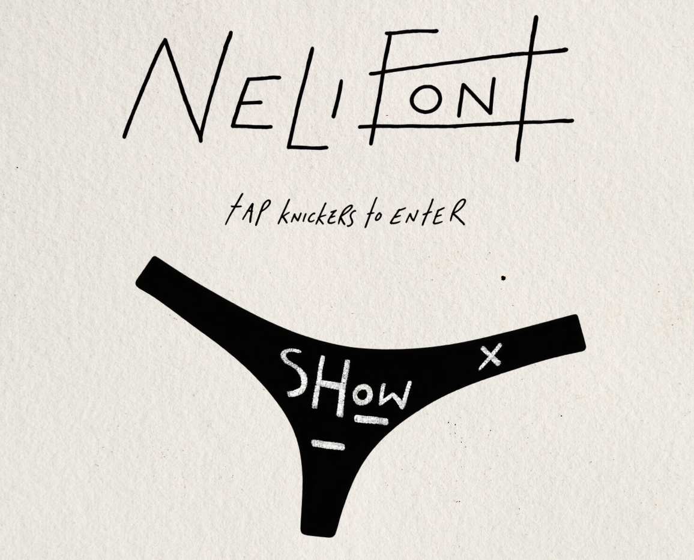
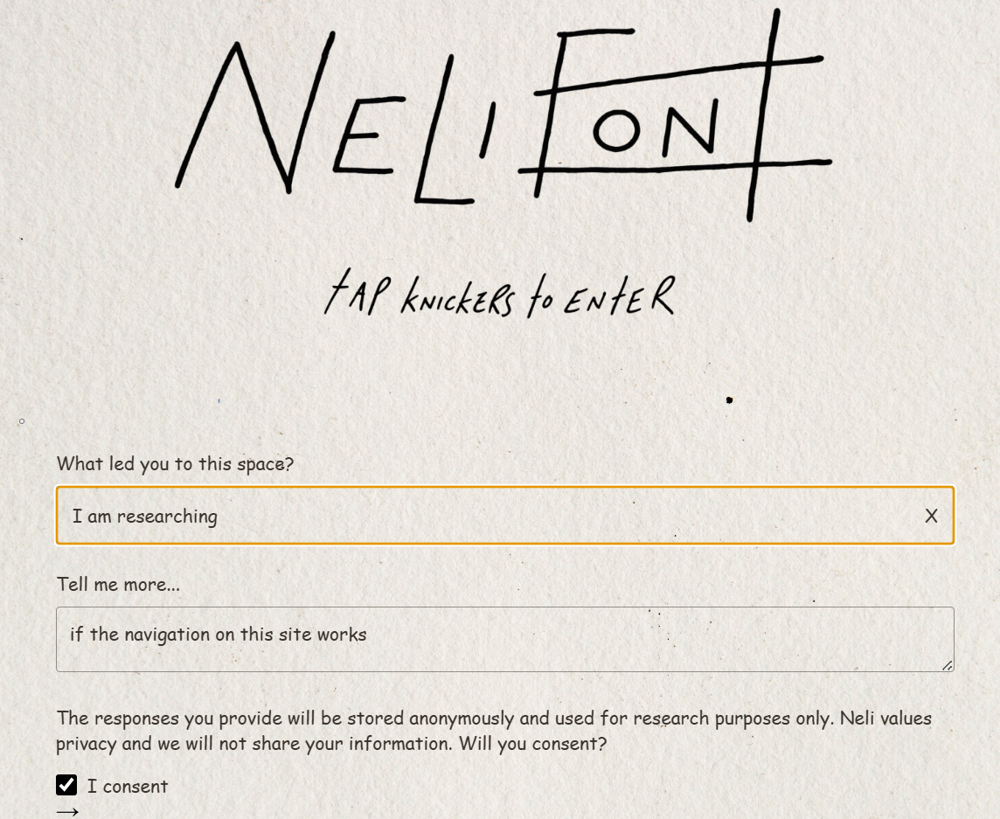
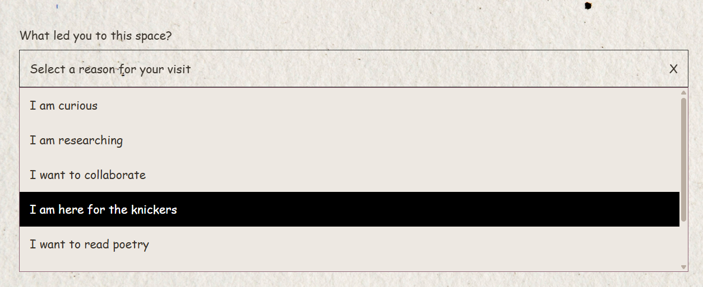
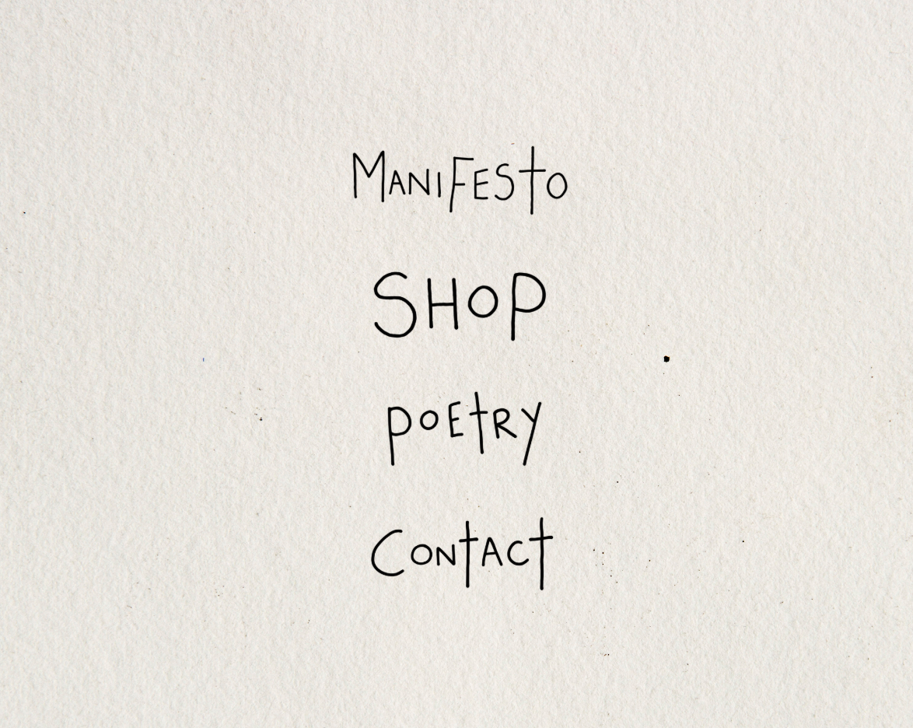
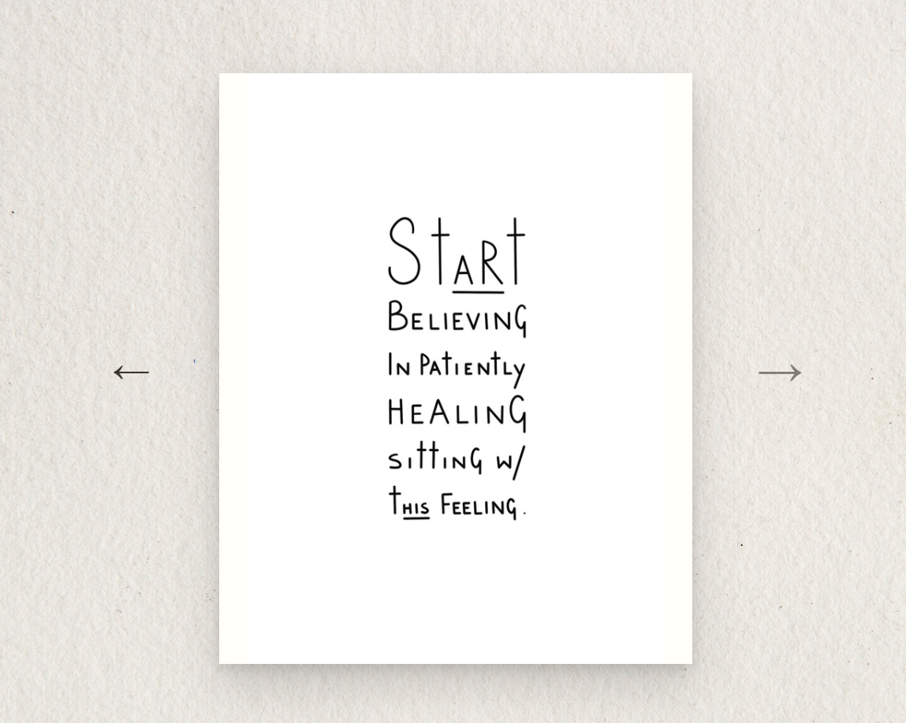
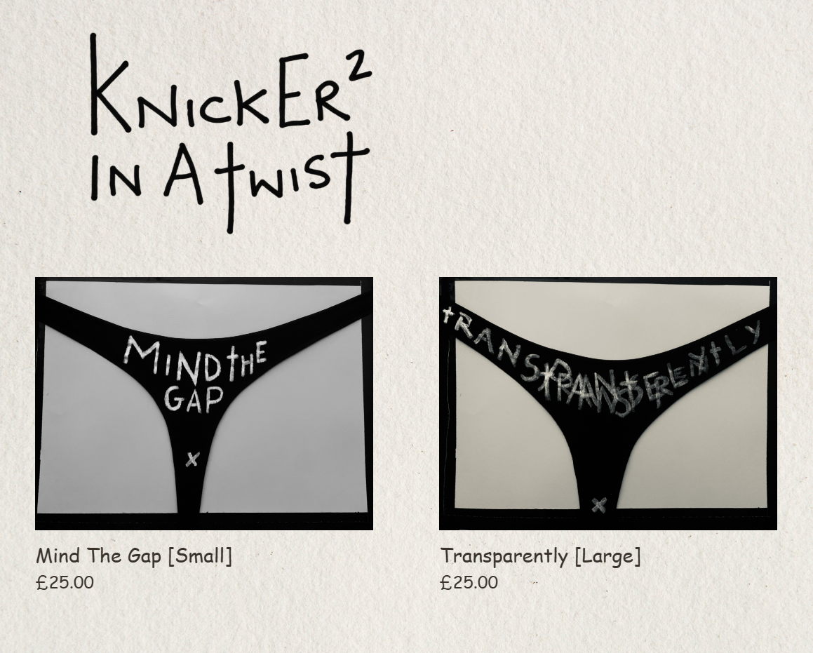
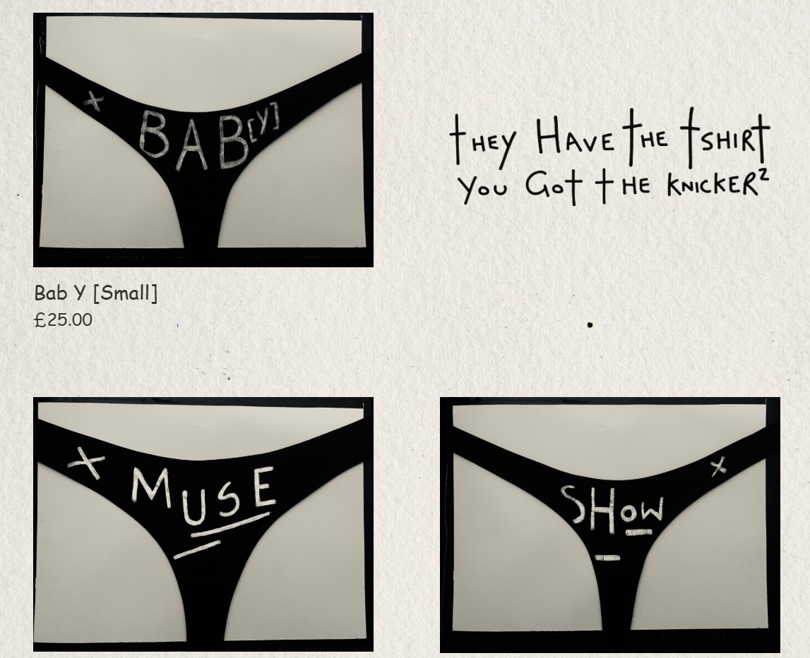
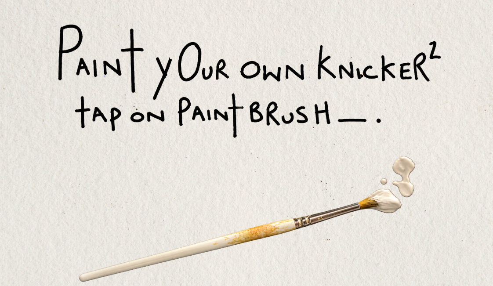

# Indie Artist Web-App

**Full-Stack Web Development | Python | Django | SQL | HTML | CSS | JavaScript**

An evolving, artist-led commerce web application developed to explore the design and technical foundations of an independent digital environment for showcasing, archiving and selling creative work.

The project combines frontend experimentation with Python backend development, relational database design and considerations around security, usability and future commercial functionality.

---

## Project Overview

This self-directed project explores how an independent multidisciplinary artist can develop and manage an online commercial environment through a custom-built web application.

The original concept emerged from an experimental website for an artist's studio-on-the-road: a digital space where visitors could explore an artistic identity, discover creative work, read poetry and engage with the artist's wider practice.

What began as a visual experiment gradually developed into a Django-powered application incorporating multiple pages, interactive elements, visitor forms and database functionality.

As the project evolved, the focus shifted towards understanding how the application could be structured to support future commercial requirements. This introduced new areas of development, including backend architecture, relational database design, data management, security and maintainability.

This repository presents the portfolio-facing technical development of the application. It documents the current implementation, architectural decisions, technical learning and future development priorities.

The application remains under active development. Completed functionality is distinguished from proposed features and future objectives throughout this documentation.

## Project Objectives

The main objectives are to:

- Develop an independent, artist-led commerce web application.
- Translate an experimental visual concept into a functional website.
- Build a Python backend using Django.
- Apply relational database concepts to a practical commercial scenario.
- Explore how product inventory, editions, customers and orders can be structured and managed.
- Implement visitor engagement and contact functionality.
- Investigate secure handling of user input, authentication and environment variables.
- Develop responsive interfaces for desktop and mobile browsers.
- Establish a maintainable application architecture that can support future development.

## Creative Assets and Intellectual Property

To protect the original creative work associated with the N3L1F0NT project, certain proprietary creative assets have been intentionally excluded from this public repository.

These include original artwork, photography, illustrations, poetry, product imagery, visual materials and other creative content.

This repository focuses on demonstrating the technical development of the application, including its Django backend, database architecture and frontend implementation.

As a result, some visual elements may be missing when cloning and running the project locally. Their absence is intentional and does not indicate an incomplete application structure.

The original creative assets remain separate from this repository. Their appearance in project documentation or screenshots does not grant permission for their reproduction, redistribution, adaptation or use.

## Current Web-Application Preview

The following screenshots document the current development stage of the N3L1F0NT website.

The interface combines an experimental visual environment with a Django-powered web application.

### Entry Page

The original entry experience introduced a password-protected gateway into the website. This concept is being reconsidered as a separate hidden experience, with the main website prioritising accessibility and straightforward navigation.



### Visitor Form

A Django-based visitor questionnaire explores audience engagement through predefined response categories, an optional personal response and a consent field. The initial password-entry concept is being repurposed as a potential hidden experience for returning visitors and customers.






### Website Navigation

The navigation connects four principal areas of the website:

- Manifesto
- Shop
- Poetry
- Contact

The interface uses handwritten graphics, a paper-inspired background and subtle hover animations. The navigation was deliberately simplified following initial user testing and consideration of mobile usability.



### Poetry

The poetry section presents original writing as scanned and digitally edited handwritten compositions. Rather than relying exclusively on conventional text rendering, the visual presentation preserves the physical qualities of the original handwritten work.



### Shop

The shop introduces a minimal product grid for the limited-edition *Knickers in a Twist* collection.

Product presentation draws on physical documentation methods, including artwork photographed against a reusable sketchpad and gaffer-tape display board.

The shop is being developed towards database-managed product information, inventory and future order management.







*Screenshots represent the current development version. Interface design, functionality and responsiveness remain subject to ongoing refinement.*

---

## Database Design and SQL Documentation

The database design is developed separately from the main Django application to allow independent experimentation with relational database concepts and SQL.

A dedicated documentation file covers the proposed commerce database architecture, entity relationships, SQL development process and implementation roadmap.

For further details, see:

**[View SQL Database Design and Documentation](database/README.md)**

This documentation includes the Entity Relationship Diagram (ERD), proposed database tables, key relationships, business requirements and planned integration with Django ORM.

## Technology Stack

| Technology | Purpose |
|---|---|
| HTML5 | Page structure and Django templates |
| CSS3 | Visual design, layouts, animations and responsive styling |
| JavaScript | Interactive elements, modal behaviour and custom dropdown functionality |
| Python | Backend programming |
| Django | Web framework, routing, forms, models and administration |
| SQLite | Local development database |
| Django ORM | Database interaction through Python models |
| SQL | Relational database concepts, querying and data management |
| Python-Dotenv | Loading environment variables |
| Git and GitHub | Version control and project development |

**Development environment:** Visual Studio Code, Python virtual environment and Django development server.

SQLite is currently used for local development. A production database such as PostgreSQL or MySQL may be considered as the application develops.

## Project Structure

```text
Full-Stack-Data-Driven-Commerce-App/
│
├── backend/
│   │
│   ├── application/
│   │   ├── contact/
│   │   ├── shop/
│   │   ├── static/
│   │   ├── templates/
│   │   │
│   │   ├── visitor_form/
│   │   │   ├── migrations/
│   │   │   ├── admin.py
│   │   │   ├── forms.py
│   │   │   └── models.py
│   │   │
│   │   ├── __init__.py
│   │   ├── admin.py
│   │   ├── apps.py
│   │   ├── models.py
│   │   ├── urls.py
│   │   └── views.py
│   │
│   ├── configuration/
│   │   ├── __init__.py
│   │   ├── asgi.py
│   │   ├── settings.py
│   │   ├── urls.py
│   │   └── wsgi.py
│   │
│   └── manage.py
│
├── database/
│   ├── schema/
│   ├── qeries/
│   └── README.md
│
├── docs/
│   └── screenshots/
│
├── .env.example
├── .gitignore
├── README.md
└── requirements.txt
```

**Local development files intentionally excluded from the public repository:**

- `.venv/` — local Python virtual environment.
- `.env` — private environment variables.
- `db.sqlite3` — local development database.
- `nelifont.sqlite3` — original project database.
- `__pycache__/` — generated Python cache files.
- Original proprietary creative assets.

The `contact/` and `shop/` directories form part of the intended application structure. Their functionality remains under development.

## Why Django?

I initially explored the relationship between frontend development and Python backend frameworks, comparing Flask and Django.

I selected Django because its integrated functionality provides a practical foundation for developing a structured web application.

In particular, Django provides:

- URL routing and view management.
- Template rendering.
- Database models and ORM functionality.
- Form handling and validation.
- Database migrations.
- An administrative interface.
- Built-in authentication and password-hashing functionality.

This allowed the project to move beyond a static visual prototype towards an application capable of processing and storing visitor information.

The decision also provided an opportunity to develop transferable Python backend skills while exploring how frontend components communicate with server-side functionality.

## Database Development

An important objective is to apply relational database concepts to a practical commercial environment.

The initial database implementation focuses on visitor engagement. Future development will extend the data model towards product inventory, editions, customers and transactions.

### Implemented: Visitor Response Model

The first database functionality introduced was a visitor questionnaire.

The `VisitorResponse` model contains the following fields:

| Field | Purpose |
|---|---|
| `reason_for_visit` | Stores the visitor's selected reason for visiting |
| `personal_response` | Stores a written response |
| `consent` | Records the visitor's consent selection |
| `submitted_at` | Automatically records the submission timestamp |

The implementation uses Django's ModelForm functionality to connect the visitor interface to the underlying model.

This introduced several database and backend concepts:

- Models define the structure of stored information.
- Forms collect and validate user input.
- Migrations translate model changes into database structure.
- The ORM enables database operations through Python.
- SQLite provides persistent local data storage.

### Proposed: Shop Database Architecture

The next stage involves developing a relational database structure for the commercial side of the website.

The proposed product categories include:

- Original artwork.
- Fashion and textile pieces.
- Prints and digital assets.

The database design will consider:

- Product categorisation.
- Product descriptions and pricing.
- Physical and digital product formats.
- Unique and limited editions.
- Individual edition-number tracking.
- Multiple images per product.
- Inventory availability.
- Customer records.
- Orders and associated order items.

A key learning objective is understanding how relational tables connect through primary keys and foreign keys, and how database constraints help maintain data integrity.

The intention is to use the project as a practical environment for developing SQL knowledge alongside Django ORM functionality.

## Development Journey and Technical Decisions
### Mon 9th - Fri 20th November

The project has developed through an iterative process of experimentation, implementation, debugging and refinement.

### Frontend Foundations 

**Objective:** Translate an initial visual concept into an interactive website interface.

Work included:

- Establishing the initial HTML, CSS and JavaScript structure.
- Developing the entry-page concept.
- Integrating custom image assets and interface graphics.
- Creating a password-entry interface and modal.
- Experimenting with positioning, visibility and transitions.
- Exploring separate image assets to support independent animation.

**Technical learning:** DOM manipulation, JavaScript element selection, CSS positioning and the separation of structure, presentation and behaviour.

### Backend Framework Selection 

**Objective:** Move from a static website towards a Python-powered web application.

Work included:

- Exploring how frontend components communicate with a backend.
- Comparing Flask and Django.
- Selecting Django as the application framework.
- Investigating routing, backend functionality and database integration.
- Considering future requirements for visitor records, authentication and an online shop.

**Technical learning:** Frontend/backend architecture, Python web frameworks and the distinction between local development and deployment.

### Django Integration 

**Objective:** Connect the visitor interface to Django.

Work included:

- Integrating the frontend into Django templates.
- Developing the visitor form structure.
- Exploring Django models and ModelForms.
- Connecting custom dropdown interactions to form fields.
- Investigating JavaScript DOM errors involving `getElementById()` and `classList`.
- Refining modal interactions and form behaviour.

**Technical learning:** Django template rendering, form handling, DOM readiness and JavaScript interaction with dynamically rendered page elements.

### Project Restructuring and Debugging 

**Objective:** Establish a more organised Django project structure.

Work included:

- Restructuring the Django project and application directories.
- Updating application configuration and Python import paths.
- Investigating `ModuleNotFoundError` errors following restructuring.
- Updating `INSTALLED_APPS` and URL references.
- Retaining the original Django application label `pen` to preserve existing migration history.
- Resolving configuration errors and restoring the development server.

**Technical learning:** The distinction between a Django project package, application directory and application label, and the importance of maintaining consistent references when restructuring a project.

### Functionality, Usability and Commercial Design 

**Objective:** Establish the essential website experience before expanding into more complex features.

The initial design concept was an animated digital studio that visitors could explore through playful visual interactions.

Following initial testing with three users, I reconsidered the balance between visual experimentation and usability.

Several observations informed subsequent decisions:

- Navigation needed to be more immediately recognisable.
- The entry process could introduce unnecessary friction for returning visitors.
- Mobile users needed straightforward access to the shop, poetry, manifesto and contact pages.
- Additional interactive features should not interfere with essential commercial functions.

Consequently, I simplified the homepage navigation and prioritised four main sections.

**Frontend development included:**

- Creating the main navigation menu.
- Connecting individual pages through Django views and URL patterns.
- Applying consistent visual styling.
- Introducing hover-based scaling interactions.
- Developing a swipeable poetry-viewing experience.
- Creating the initial shop grid and product presentation.

**Commercial design considerations:**

The shop's product presentation draws on the artist's existing physical documentation process.

Artwork is photographed using a repeatable sketchpad and display-board arrangement, creating a consistent format for product presentation and archiving.

The artist's use of thermal printing for physical documentation and customer receipts also informed the shop's minimal, receipt-inspired visual direction.

**Technical learning:** Django URL routing, reusable visual styling, image-based content presentation, user-centred design and the importance of prioritising essential functionality over additional interface complexity.

## Security, Version Control and Development Practices

As the prototype developed into a more substantial application, I began reviewing the relationship between experimentation and responsible software development.

The initial development process prioritised getting the concept working. As the project matured, I recognised the importance of separating public portfolio material from local development artefacts.

Work in this area includes:

- Introducing `.gitignore` to exclude local environment files and generated Python cache files.
- Excluding local SQLite databases from the public repository.
- Reviewing environment-variable management.
- Considering secure handling of Django settings.
- Exploring Django's built-in authentication and password-hashing functionality.
- Separating application configuration from user-facing functionality.

The intention is to continue developing security practices alongside application functionality rather than treating security as a final deployment task.

## Future Development Roadmap

Development will continue in stages, with functional requirements taking priority over additional visual features.

### Phase 1 — Establish the Foundations

- Complete visitor form testing.
- Verify database persistence.
- Confirm Django admin access.
- Review responsive layouts.
- Refine navigation and accessibility.
- Complete the manifesto and contact pages.

### Phase 2 — Database and Commercial Functionality

- Design and implement the shop database schema.
- Establish product and product-edition relationships.
- Implement inventory management.
- Connect product information to Django views and templates.
- Develop customer and order data structures.

### Phase 3 — Security and User Experience

- Review authentication and password handling.
- Implement appropriate access controls.
- Validate and protect submitted form data.
- Introduce returning-visitor functionality where appropriate.
- Improve mobile usability and accessibility.

### Phase 4 — Extended Interactive Environment

Explore additional features once essential commercial functions are established:

- A hidden customer area accessible through a purchase-related invitation.
- An interactive digital studio with objects representing different areas of the artist's practice.
- A multimedia journal documenting performances and the studio-on-the-road.
- Anonymous audience contributions.
- Moderated, turn-based dialogue and discussion experiences.
- Interactive artwork customisation.

These features remain exploratory rather than committed development requirements.

## Project Reflection

This project has become an opportunity to explore the relationship between creative autonomy and technical problem-solving.

As a multidisciplinary artist working across fashion, film, music and visual art, I wanted to understand whether a digital environment could become an extension of an existing artistic practice rather than relying entirely on conventional website-building platforms.

The initial visual concept was deliberately ambitious. I imagined a digital studio visitors could navigate through animated objects, hidden rooms and interactive experiences.

However, developing the application introduced a different set of questions:

How should visitor information be stored? How do different pages communicate? How can product information be managed? What happens when a customer purchases a limited-edition item? How should the application protect information and remain maintainable as it grows?

These questions shifted the project from visual experimentation towards full-stack development.

I began learning Django to understand backend architecture, and SQLite and SQL to explore how commercial information could be structured, stored and retrieved.

The most valuable part of the process has been learning to translate an idea into a sequence of technical decisions, investigate errors and refine the application through testing.

I have also learned that functionality and design are not competing priorities. Good design includes making an application understandable, accessible and useful.

The result is an evolving project that brings together artistic direction, frontend development, Python programming and database design.

**The longer-term ambition is to create an independent digital commercial environment that supports an artist's business while preserving the character of the work itself.**

## Repository and Development Notes

This is the public-facing technical development repository. It contains the application source code and documentation required to understand the project without exposing private development material.

The project remains under development. Features described as proposed, planned or exploratory should not be interpreted as completed functionality.

Future updates will document:

- Technical milestones.
- Database implementation.
- Security improvements.
- Testing and debugging.
- Commercial functionality.
- Deployment.

## Learning Resources and References

The following resources informed the development and learning process.

**HTML and CSS**

- [W3Schools — HTML Introduction](https://www.w3schools.com/html/html_intro.asp)
- [MDN — CSS box-sizing](https://developer.mozilla.org/en-US/docs/Web/CSS/box-sizing)
- [MDN — CSS transitions](https://developer.mozilla.org/en-US/docs/Web/CSS/transition)
- [MDN — CSS font-family](https://developer.mozilla.org/en-US/docs/Web/CSS/font-family)
- [Stack Overflow — Inline Flex vs Flex](https://stackoverflow.com/questions/27418104/whats-the-difference-between-displayinline-flex-and-displayflex)

**Python and Django**

- [Django Documentation](https://docs.djangoproject.com/)
- [GeeksforGeeks — Django Installation and Setup](https://www.geeksforgeeks.org/python/django-installation-and-setup/)

**Visual Assets**

- [Magnific — Sketchbook Paper Background](https://www.magnific.com/free-photo/white-wall-background_969304.htm)

---

**Project:** N3L1F0NT Artist Commerce Web Application  
**Development approach:** Self-directed, iterative development  
**Repository purpose:** Technical portfolio and ongoing project documentation  
**Status:** Active development